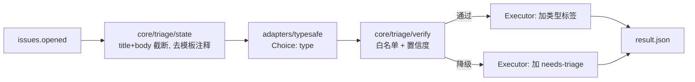
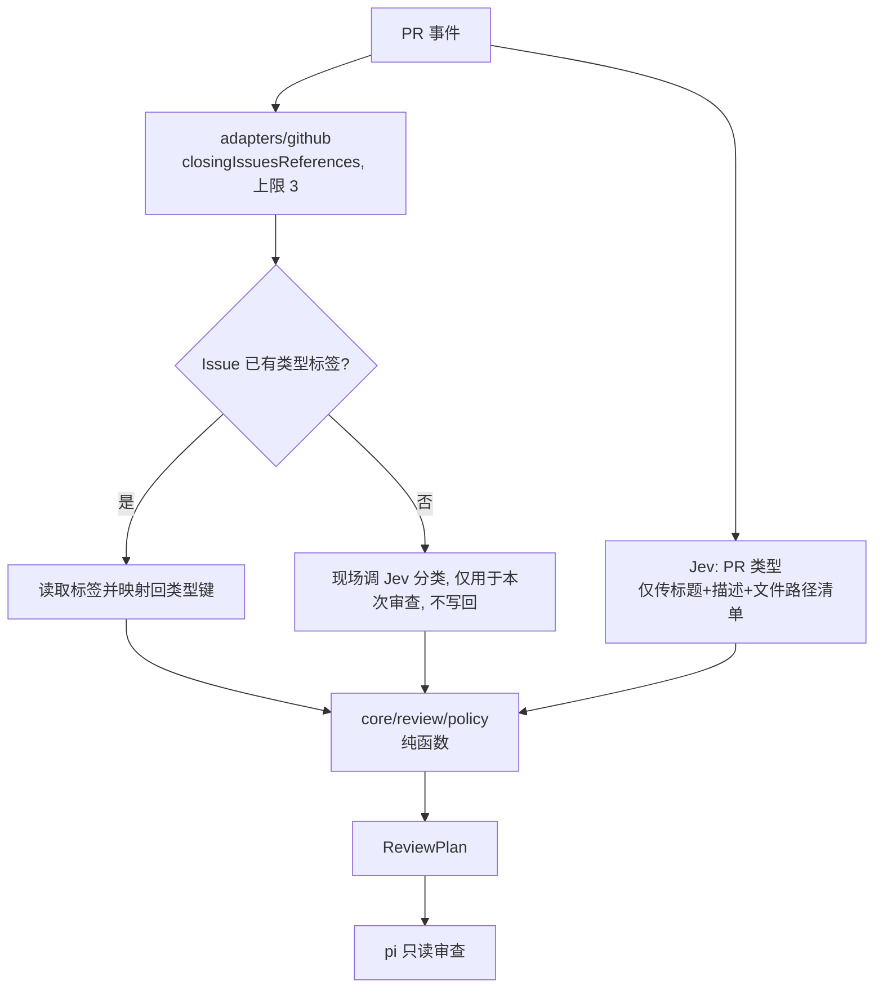

# Issue 自动分类与 PR 审查联动设计

本文是 [architecture-v2.md](./architecture-v2.md) 的增量设计：引入 TypeSafe 的 **Jev**（System One 判别式模型）做 Issue 类型分类，并把分类结果作为 PR 审查（pi）的路由输入。

状态：已实现（v2.0.0）。排期与验收矩阵见 [§9](#9-排期与验收)。

---

## 1. 目标与非目标

目标：

1. 新 Issue 自动打上类型标签，类型清单由仓库配置，默认 `bug / feature / question / docs / other`。
2. 不确定时不猜：低置信度或落入兜底类型，一律降级为 `needs-triage`，交给人。
3. PR 审查读取关联 Issue 的类型与 PR 自身类型，调整审查侧重点。

非目标（第一版不做）：

- 优先级、模块、重复 Issue 检测等其他维度。
- 二次模型投票、自一致性校验（Jev 自带校准过的置信度，见 §2）。
- 让 Jev 参与代码审查或校验 `Finding`。
- 自动创建标签、自动关闭 Issue、自动评论。

---

## 2. 关键事实：Jev 是什么，不是什么

来源：docs.typesafe.ai（`/api/system-one`、`/models`、`/confidence`、`/primitives/choice`）。

| 事实 | 对设计的影响 |
| --- | --- |
| `POST https://api.typesafe.ai/v1/systemone`，`Authorization: Bearer $TYPESAFE_API_KEY` | 一个 HTTP 调用即可，不需要 pi 或任何 agent 进程 |
| 请求 `{model, state, questions}`；`state` 可为字符串 / JSON 对象 / 数组 | `state` 用结构化 JSON，而不是拼接 prompt |
| Choice 题：`criteria` 是 `{选项: 描述}`；返回 `{choice, confidence, probabilities}` | 类型清单天然就是 `criteria`，同时也是 Verifier 白名单 |
| `confidence` 由 `probabilities` 的分布形状算出，0 到 1 | 直接作为门限；选项数不同，同一个数值含义略有差异，阈值需按清单大小校准 |
| 不生成文本、不调用工具 | 提示词注入的最坏后果是"分错类"，且被白名单与置信度门限约束，不会越权 |
| 输入计费，输出免费；单请求 64k token | 成本可忽略；`state` 需截断 |
| 429 / 529 可重试；400 / 401 / 422 不可重试 | 重试策略见 §6 |
| `jev-latest` 是会移动的别名 | **必须固定版本号**（默认 `jev-1.14.0`），否则阈值会随模型升级失效 |

由此得到的架构结论：Jev 只经由 `adapters/typesafe.ts` 接入，**不经过 `CapabilityPolicy`**（该策略只约束 pi 子进程）。第一版只有 Choice 一种题型。

### 2.1 决策记录

| 决策 | 理由 | 代价与移除条件 |
| --- | --- | --- |
| 数据外发到 TypeSafe 可接受 | 用户确认；官方声明不以客户数据训练，ZDR 仅企业客户 | 私有仓库的 Issue 文本会离开 GitHub；若合规要求变化，可替换 `adapters/typesafe.ts`，`core` 不受影响 |
| 不对中文 Issue 做特殊处理 | 用户确认；官方称英文最佳、CJK 准确率不均 | 置信度可能整体偏低、降级比例偏高；用 `result.json` 的概率数据校准 `confidence_floor` |
| 类型清单可配置 | 不同仓库标签体系不同 | 配置校验见 §4 |

---

## 3. 总体流程

### 3.1 Issue 分类（T1）



### 3.2 联动（T2）



两个流程独立运行：PR 审查读取 Issue 上**已有的标签**，不依赖 T1 的 job 是否完成；Issue 尚未分类时现场补一次，不写回，避免 PR job 持有 `issues: write`。

---

## 4. 配置：`.github/triage.yml`

```yaml
model: jev-1.14.0            # 固定版本，不使用 jev-latest
confidence_floor: 0.6        # 低于此值降级
fallback: other              # types 中的一个键：命中即降级
max_body_chars: 8000         # state 中正文截断长度
types:
  bug:      { label: type/bug,      description: "行为与预期不符、崩溃、回归" }
  feature:  { label: type/feature,  description: "新增能力或改进现有能力的请求" }
  question: { label: type/question, description: "使用方式、咨询、非缺陷类求助" }
  docs:     { label: type/docs,     description: "文档缺失或错误" }
  other:    { label: needs-triage,  description: "以上都不是，或信息不足以判断" }
```

未提供配置文件时使用上面的默认值。

### 4.1 配置校验（边界校验，启动时一次完成）

| 规则 | 失败行为 |
| --- | --- |
| 键匹配 `^[a-z][a-z0-9_-]{0,31}$` | 配置错误，退出码 `Infrastructure` |
| `types` 至少 2 项、至多 20 项 | 同上（Jev 本身上限 255，这里是自我约束） |
| 每项 `description` 非空 | 同上；描述会原样发给模型，决定分类质量 |
| `label` 全局唯一，且非空 | 同上 |
| `fallback` 必须是 `types` 中的键 | 同上 |
| `confidence_floor` 在 (0, 1] | 同上 |
| `model` 不得以 `-latest` / `-preview` 结尾 | 同上，避免阈值随别名漂移（可显式关闭，见 §10） |
| 所有 `label` 必须已存在于仓库 | 运行时检查；缺失即报错，**不自动创建** |

`fallback` 项的 `label`（默认 `needs-triage`）同时是降级时使用的标签，所以"降级"和"落入兜底类型"走同一条路径。

### 4.2 Jev 请求形状

```json
{
  "model": "jev-1.14.0",
  "state": { "title": "...", "body": "..." },
  "questions": {
    "type": {
      "type": "choice",
      "instructions": "What kind of issue is this?",
      "criteria": { "bug": "...", "feature": "...", "question": "...", "docs": "...", "other": "..." }
    }
  }
}
```

问题 id 固定为 `type`；`criteria` 由配置的 `types` 生成，顺序保持配置顺序。

---

## 5. Verifier：白名单加置信度

`core/triage/verify.ts` 是纯函数：`verify(config, response) → TriageDecision`。检查顺序固定，**第一个失败的检查决定结论**。

| 步骤 | 检查 | 失败结论 |
| --- | --- | --- |
| 1 | 响应 schema：存在 `answers.type`，`type === "choice"`，`confidence ∈ [0,1]`，`probabilities` 的键是配置键的子集，且总和在 `1 ± 1e-3` | `invalid_response`，不打标签，退出码 `InvalidReport` |
| 2 | `choice` 必须是配置中的键 | `invalid_response`（同上） |
| 3 | `choice !== fallback` | `degraded`，原因 `fallback_selected` |
| 4 | `confidence >= confidence_floor` | `degraded`，原因 `low_confidence` |
| 5 | 通过 | `accepted`，标签为 `types[choice].label` |

```ts
type TriageDecision =
  | { kind: "accepted"; type: string; label: string; confidence: number }
  | { kind: "degraded"; label: string; reason: "fallback_selected" | "low_confidence";
      top: string; confidence: number }
  | { kind: "invalid"; reason: string };
```

降级是**正常结果**，退出码为 `Ok`，`verdict` 为 `degraded`。只有响应本身违约才是 `InvalidReport`。

---

## 6. Executor、权限与失败语义

### 6.1 Executor（`adapters/github`）

- 只有 `triage` 的写步骤持有 `issues: write`；整个 job 不检出代码。
- 幂等：Issue 已带有任一配置中的类型标签（含 `fallback` 标签）时**跳过**，人工设置优先。
- 只在 `opened` 触发；不响应 `edited`、`labeled`，避免标签抖动与循环触发。
- 只增加一个标签，不删除任何已有标签。
- 并发：`concurrency: group: triage-${{ github.event.issue.number }}`。

### 6.2 失败语义

| 场景 | 处理 | 退出码 |
| --- | --- | --- |
| Jev 429 / 529 / 网络超时 | 带 jitter 的指数退避，最多 3 次，单次超时 15s | 耗尽后 `Infrastructure` |
| Jev 400 / 401 / 422 | 不重试 | `Infrastructure` |
| 响应违约（Verifier 步骤 1、2） | 不打标签 | `InvalidReport` |
| 低置信度、落入兜底类型 | 打 `fallback` 标签 | `Ok` |
| 标签在仓库不存在 | 报配置错误 | `Infrastructure` |
| GitHub 写入失败 | 不重复打标签（幂等），报错 | `Infrastructure` |

退出码沿用 v2 的 `ExitCode`。triage job **不应设为 required check**，分类失败不阻塞任何合并。

### 6.3 凭据

| 凭据 | 持有者 |
| --- | --- |
| `TYPESAFE_API_KEY` | triage 的分类步骤、PR 审查的分类步骤；**不进入 pi 子进程**（由 env 白名单保证） |
| `issues: write` | 仅 triage 的写步骤 |
| `issues: read` | PR 审查（读取关联 Issue 标签） |

---

## 7. 联动细则

### 7.1 `ReviewPlan`

`core/review/policy.ts`：`plan(input) → ReviewPlan`，纯函数，可表驱动测试。

```ts
interface PolicyInput {
  issueTypes: string[];          // 配置键，来自关联 Issue；可为空
  prKind: PrKind | "unknown";    // Jev 对 PR 的分类结果，低置信度归 unknown
  inventory: DiffInventory;
}
interface ReviewPlan {
  focus: string[];               // 追加到审查提示词的固定短语，来自代码内常量表
  thinking?: ThinkingLevel;      // 仅可在配置值基础上下调，不上调
  notes: string[];               // 写入评论的提示，如类型错配
}
```

`PrKind` 默认 `feature | bugfix | refactor | docs | deps | chore`，由内置默认配置给出；PR 类型与 Issue 类型是**两套独立清单**，PR 清单第一版不开放配置（YAGNI，需要时再提取）。

### 7.2 默认规则表

| 条件 | 效果 |
| --- | --- |
| 关联 Issue 含 `bug` | focus：是否有回归测试；修的是根因还是症状 |
| 关联 Issue 含 `feature` | focus：公共 API、文档、测试是否同步；是否有范围蔓延 |
| Issue 为 `bug` 而 `prKind` 为 `docs`（及其他明显错配） | notes：PR 类型与关联 Issue 不符 |
| `prKind = docs` | thinking 下调一档 |
| `prKind = deps` | **不跳过**；focus：lockfile 变更、新增依赖来源、版本区间放宽 |
| 无关联 Issue 且 `prKind = unknown` | 空计划，行为与现状一致 |

错配判定只使用代码中的显式映射表（Issue 类型键 → 允许的 PrKind 集合）。Issue 清单是自定义的，未出现在映射表中的键**不参与错配判断**。

### 7.3 注入面控制

- 进入 pi 提示词的只有 `focus` 常量短语与枚举值。**Issue 标题、正文不进入提示词。**
- 需要 Issue 正文时（核对验收点），作为带"不可信内容"标注的文件写入 `contextDir/linked-issues/<n>.md`，并在 `manifest.json` 登记；由输入 `include_issue_body`（默认 `false`）控制。
- PR 分类的 `state` 只含标题、描述与文件路径清单，不含 diff。

### 7.4 PR 分类的 Jev 请求

问题 id 为 `kind`，选项为 `PrKind` 默认集；低于同一个 `confidence_floor` 归 `unknown`，**不降级为任何标签、不写入 PR**。

---

## 8. 代码落点

```
packages/
  contracts/src/triage.ts          TriageConfig, Classification, TriageDecision
  core/src/triage/config.ts        配置解析与 §4.1 校验、默认值
  core/src/triage/state.ts         title/body → state（截断、去 HTML 注释）
  core/src/triage/verify.ts        §5
  core/src/review/policy.ts        §7（T2）
  adapters/src/typesafe.ts         fetch、超时、退避、响应 schema 校验
  adapters/src/github.ts           新增：labels 读写、linked issues（T2 仅读）
  actions/src/triage-issue.ts      入口装配
triage/action.yml                  新子 action
```

边界约束：

- `core` 不 import `fetch` / `fs` / `process.env`；`adapters/typesafe.ts` 是唯一知道 Jev 响应形状的地方，对外只产出 `contracts` 类型。
- `pr-review/action.yml` 新增输入：`link_issues`（默认 `true`）、`include_issue_body`（默认 `false`）、`typesafe_api_key`、`triage_config`（默认 `.github/triage.yml`）。`link_issues` 开启但缺少 key 时，退化为不联动并写一条 notes，**不让审查失败**。
- 与 `CapabilityPolicy` 无依赖：Jev 不是 pi 子进程。

---

## 9. 排期与验收

| 阶段 | 内容 | 依赖 | 验收 |
| --- | --- | --- | --- |
| T1 Issue 分类 | `contracts/triage`、`core/triage/*`、`adapters/typesafe`、labels 读写、`triage` action | P0（workspace、tsc、vitest）；可与 P1、P2 并行 | 见下 |
| T2 联动 | `core/review/policy`、linked issues 读取、PR 分类、`pr-review` 新输入 | P3（审查管线）；接在 budget 之前，只影响 focus 与 thinking，不改 chunk 规划 | 见下 |

T1 验收（均用假 Jev 服务器，不访问真实 API）：

- `verify` 表驱动：confidence 刚好等于 / 略低于 floor；`choice` 不在白名单；`probabilities` 含未知键；概率和越界；选中 fallback。
- 配置校验：§4.1 每条规则一个失败用例，加默认配置通过用例。
- `adapters/typesafe`：200、429 退避后成功、429 耗尽、401、422、响应缺字段、超时。
- Executor：Issue 已有类型标签则零写入；重复投递同一事件只产生一次写入；标签不存在时报错且零写入。
- 环境隔离：构造含 `TYPESAFE_API_KEY` 的环境，断言 pi 子进程环境不含它。

T2 验收：

- `policy` 表驱动覆盖 §7.2 每一行，加"未知 Issue 类型键不触发错配"。
- 提示词快照：给定恶意 Issue 标题与正文，断言其不出现在 pi 提示词与 argv 中。
- 缺少 key、Jev 不可达时，审查照常完成，`notes` 中有说明。

上线前先在真实 Issue 上做一次**离线校准**：用 T1 的 `result.json` 汇总 `probabilities`，据此确定 `confidence_floor`，默认的 0.6 只是官方示例里的起点。

---

## 10. 已知风险与待办

| 风险 | 影响 | 处理 |
| --- | --- | --- |
| 非英文准确率不均 | 降级比例可能偏高 | 已接受；上线前校准 floor；降级本身是安全结果 |
| 清单越大，同一 `confidence` 数值的含义越松 | 阈值不可跨清单复用 | 修改 `types` 后需重新校准；配置里保留 `confidence_floor` 与清单同处一个文件 |
| Jev 模型升级改变分布 | 阈值失效 | 固定版本号；升级时在 `result.json` 对比 `model` 字段后再切换 |
| 数据外发 | 私有仓库 Issue 文本离开 GitHub | §2.1 已记录并接受 |
| 官方 TS SDK 是否存在未确认 | 影响 `adapters/typesafe` 的实现方式 | 第一版直接 `fetch` 加 schema 校验；确认有成熟 SDK 再评估替换，替换只影响该文件 |
| 校验规则禁止 `-latest` 别名 | 个别用户想要自动跟随最新版 | 提供显式开关 `allow_floating_model: true`，默认关闭 |
